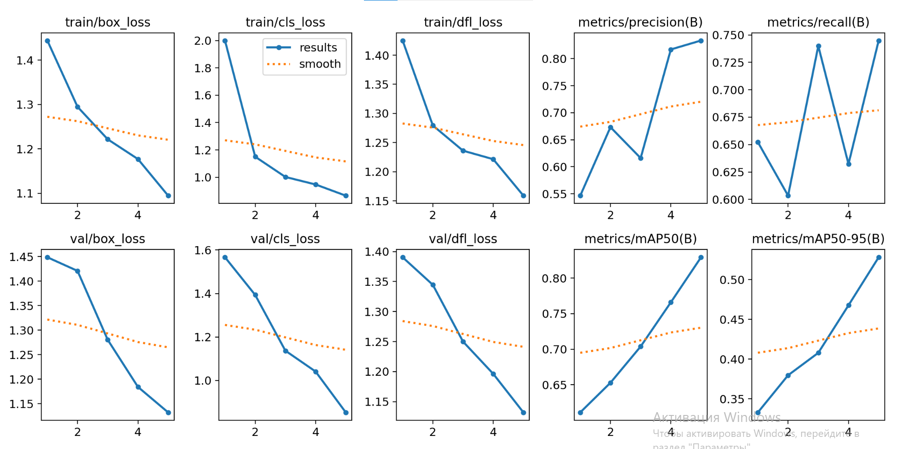
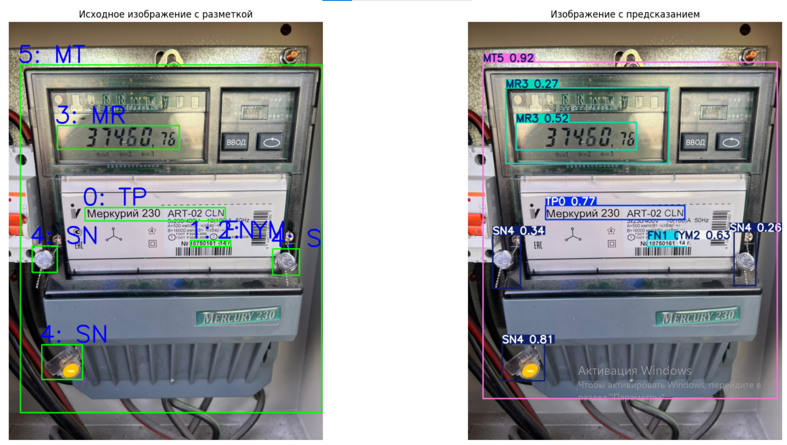
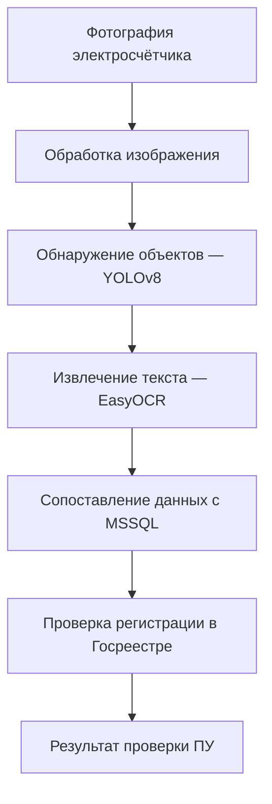

# YOLO Object Detection — распознавание электросчётчиков по фотографиям

## О проекте

Разработка системы компьютерного зрения для автоматического считывания информации с фотографий приборов учёта электроэнергии (ПУ) и последующей проверки сведений о них по официальному Государственному реестру.

Проект выполнен для автоматизации обработки фотографий счётчиков, которые снимают и загружают обходчики.

### Цель проекта

Определение возможности дальнейшей эксплуатации проверяемых приборов учёта при наличии действующей регистрации в Государственном реестре.

При отсутствии действующей регистрации система позволяет получить данные для принятия решения о замене прибора учёта в соответствии с действующими нормативно-правовыми актами.

## Постановка задачи

Разработать автоматизированное решение, которое позволяет:

- обрабатывать фотографии электросчётчиков, сделанные на мобильные устройства;
- обнаруживать необходимые объекты и области на изображениях;
- извлекать информацию с фотографий с использованием технологий компьютерного зрения и OCR;
- сопоставлять полученные сведения с записями Государственного реестра;
- определять наличие действующей регистрации прибора учёта.

## Исходные данные

Для разработки и тестирования решения использовались:

- **1 016 изображений** электросчётчиков, полученных с мобильных устройств;
- база данных Государственного реестра, содержащая **9 636 425 записей** о приборах учёта.

Изображения использовались для подготовки обучающей выборки, разметки и обучения моделей компьютерного зрения.

## Технологический стек

| Направление | Технологии |
|---|---|
| Язык программирования | Python |
| Обнаружение объектов | Ultralytics YOLOv8 |
| OCR | EasyOCR |
| Разметка данных | Label Studio, CVAT |
| Обработка изображений | OpenCV |
| Обработка данных | NumPy |
| База данных | Microsoft SQL Server (MSSQL) |
| Контейнеризация | Docker |
| Веб-сервер | Nginx |

## Мой вклад в проект

- Анализировала данные заказчика, проверяла фотографии приборов учёта и сверяла сведения о счётчиках с данными реестра.
- Подготавливала и размечала изображения для обучения моделей компьютерного зрения с использованием Label Studio и CVAT.
- Обучала модель YOLOv8 на пользовательском датасете.
- Подбирала гиперпараметры и сравнивала результаты экспериментов.
- Анализировала метрики качества детекции, выявляла признаки переобучения и работала над улучшением результатов модели.

## Обучение и оценка модели YOLOv8

Для обнаружения объектов использовалась архитектура YOLOv8.

Обучение и тестирование проводились на пользовательском датасете фотографий электросчётчиков.

Основные параметры эксперимента:

- Архитектура: YOLOv8.
- Размер изображений: 640 × 640.
- Формат разметки: YOLO.
- Среда обучения: Google Colab.
- Вычислительная платформа: GPU.

### Графики обучения



### Результаты экспериментов

**Эксперимент 1**

Валидационная выборка: 42 изображения, 267 размеченных объектов.

| Метрика | Результат |
|---|---:|
| Precision | 0.831 |
| Recall | 0.747 |
| mAP@0.5 | 0.828 |
| mAP@0.5:0.95 | 0.531 |

Значения mAP@0.5 по отдельным классам находились в диапазоне от 0.650 до 0.949.

**Эксперимент 2**

Валидационная выборка: 84 изображения, 533 размеченных объекта.

| Метрика | Результат |
|---|---:|
| Precision | 0.761 |
| Recall | 0.771 |
| mAP@0.5 | 0.823 |
| mAP@0.5:0.95 | 0.530 |

Эксперименты позволили сравнить качество обнаружения объектов на разных валидационных выборках и проанализировать результаты модели.

### Пример детекции



### Скорость инференса

В одном из прогонов время инференса составляло около **33 мс на изображение**.

Это значение относится к конкретному эксперименту и вычислительной среде.

## Общая логика решения

Система предназначена для обработки фотографии прибора учёта и проверки извлечённых сведений по базе Государственного реестра.

Упрощённая схема процесса:



*Схема иллюстрирует общую логику решения на уровне используемых технологий.*

## Результат проекта

В рамках проекта:

- обучены и протестированы модели обнаружения объектов на фотографиях электросчётчиков;
- подготовлены данные для обучения и оценки качества моделей;
- разработаны и развёрнуты на сервере заказчика Docker-контейнеры с программными компонентами решения;
- обеспечена возможность последующего дообучения моделей при расширении датасета;
- предусмотрена работа с актуализируемой базой данных приборов учёта.

Разработанное решение предназначено для автоматизации проверки сведений о приборах учёта по фотографиям и данным Государственного реестра.

## Запуск проекта

### Установка зависимостей

```bash
pip install -r requirements.txt
```

### Обучение модели

Обучение выполнялось на закрытом датасете заказчика.
Исходные данные в репозитории не публикуются.

Для воспроизведения эксперимента необходим
собственный датасет в формате YOLO.

### Инференс

Для запуска инференса необходим файл весов
обученной модели и тестовое изображение.

Веса модели и исходный датасет
не входят в публичную версию репозитория.


## Материалы проекта

Описание проекта:  
https://ai-hunter.ru/enertest


